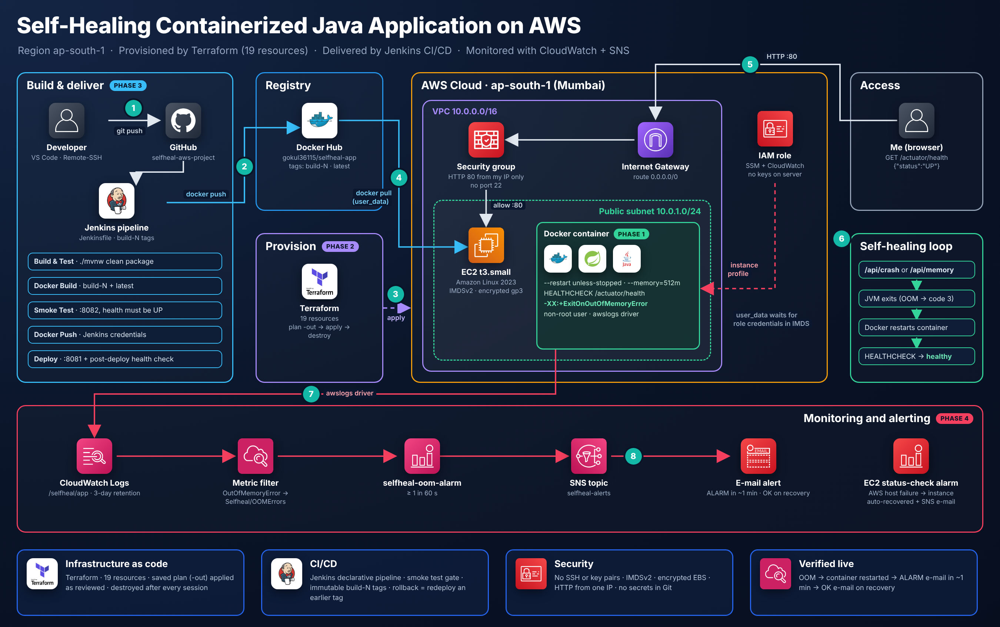
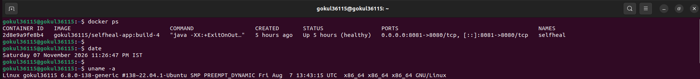
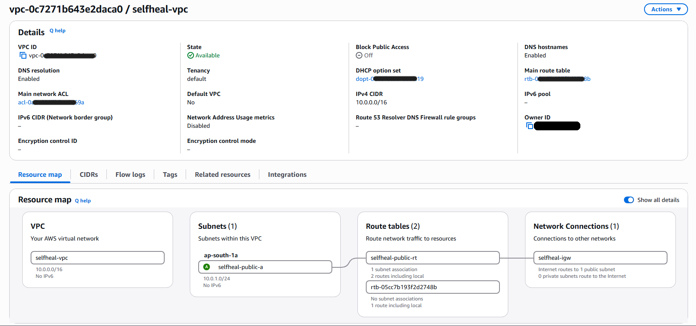
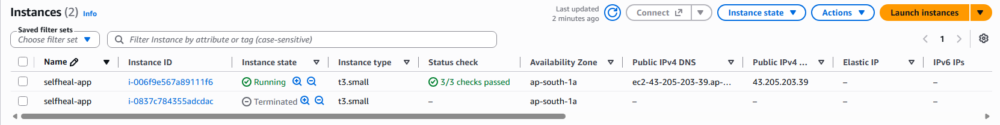
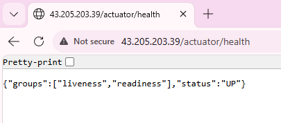
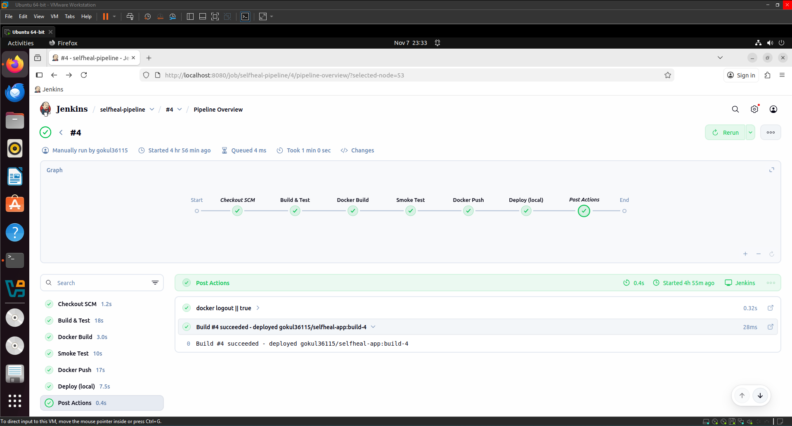
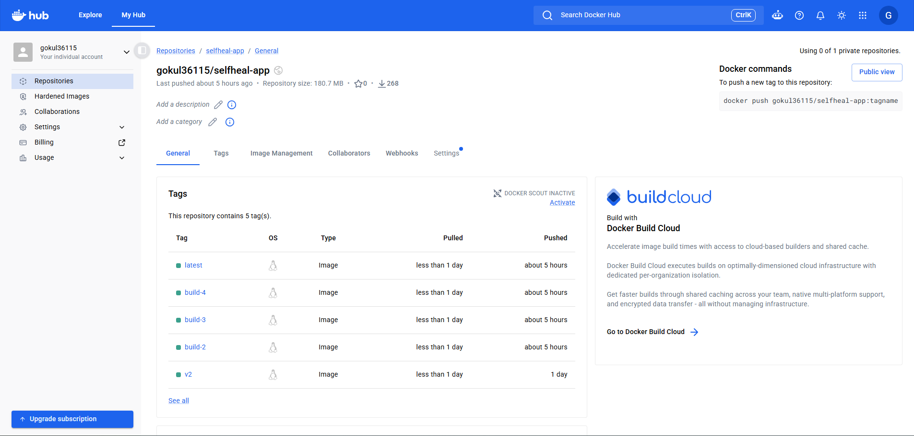
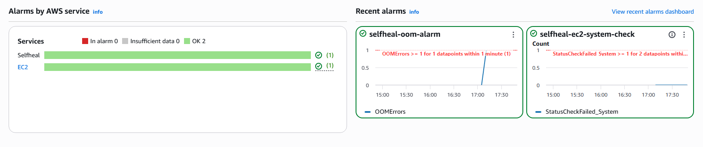
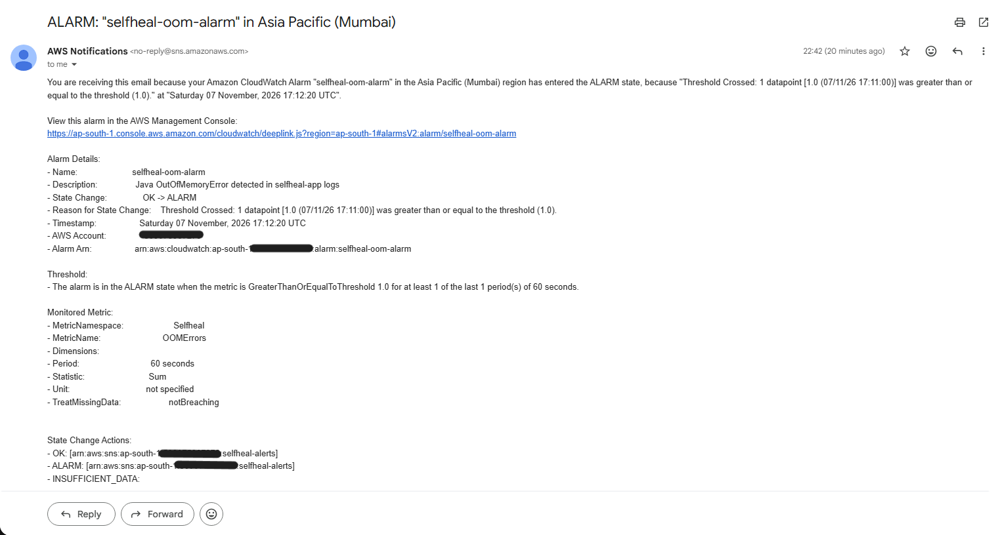
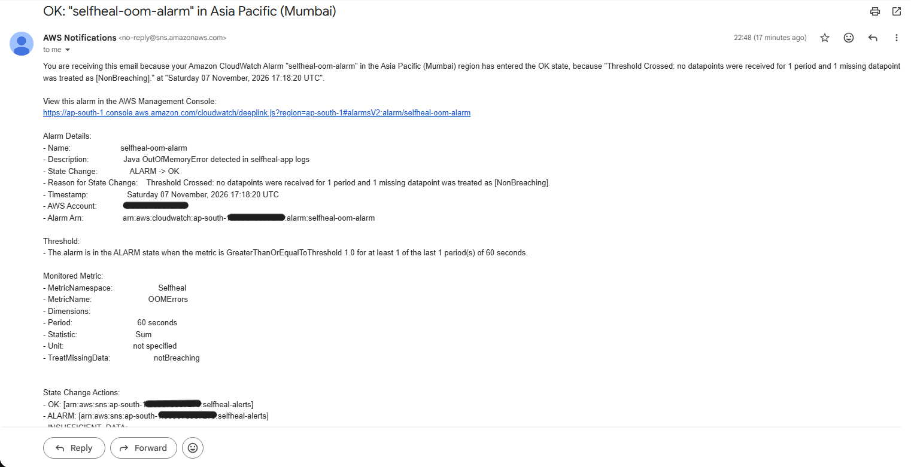

# Self-Healing Containerized Java Application on AWS

**A Spring Boot service that detects its own failures, recovers automatically and alerts within about a minute, delivered through a Jenkins CI/CD pipeline and provisioned on AWS with Terraform.**

---

## The problem
In Java middleware operations, JVM crashes, `OutOfMemoryError`s and HTTP 500s are usually discovered by a user or a monitoring ticket, and then fixed by hand: restart the server, check the logs, notify the team. This project turns that manual cycle into an automated one:

    failure  →  detected  →  recovered  →  alerted        (no human in the loop)

## Highlights
- **Self-healing verified with chaos testing:** built-in endpoints force crashes, 500s, slow responses and memory leaks, and Docker brings the service back automatically.
- **Found and fixed a silent failure:** after an `OutOfMemoryError` the JVM stayed alive returning 500s while Docker still reported it as `healthy`. Adding `-XX:+ExitOnOutOfMemoryError` makes the JVM exit (code 3) so Docker restarts it.
- **Infrastructure as Code:** 19 AWS resources (VPC, subnet, IGW, routing, security group, IAM, EC2, CloudWatch, SNS) created and destroyed with Terraform from a reviewed, saved plan.
- **Secure by default:** no SSH port and no SSH keys, IMDSv2 enforced, encrypted disk, HTTP open to a single IP, no credentials on the server or in the code.
- **CI/CD with quality gates:** every build is tested, smoke-tested in a throwaway container, pushed with a unique tag and health-checked after deploy.
- **Alerting tested live:** an OOM in production-like conditions produced an **ALARM email in about 1 minute** and a recovery email when it cleared.

## Architecture

## Tech stack
| Area | Tools |
|---|---|
| Application | Java 17, Spring Boot, Spring Boot Actuator, Maven |
| Containers | Docker (multi-stage build), Docker Hub |
| CI/CD | Jenkins declarative pipeline |
| Infrastructure as Code | Terraform (AWS provider) |
| Cloud | AWS VPC, EC2, IAM, Security Groups, CloudWatch Logs, CloudWatch Alarms, SNS |
| OS / tooling | Linux (Ubuntu, Amazon Linux 2023), Git, GitHub |

---

## 1. Application and Docker self-healing

**Chaos endpoints:** built-in "break buttons" used to prove that recovery works.

| Endpoint | What it simulates |
|---|---|
| `GET /` | Normal response (shows which container answered) |
| `GET /actuator/health` | Health check used by Docker, the pipeline and monitoring |
| `GET /api/error` | HTTP 500 application error |
| `GET /api/slow` | Slow response (15 seconds) |
| `GET /api/memory` | Allocates 50 MB per call → `OutOfMemoryError` |
| `GET /api/crash` | Kills the JVM (exit code 1) |

**Container design**
- Multi-stage build: Maven builds the JAR, and the final image holds only the JRE and the JAR
- Runs as a non-root user
- `HEALTHCHECK` on `/actuator/health` every 15 s
- `--restart unless-stopped`, `--memory=512m`, `-XX:+ExitOnOutOfMemoryError`

**Results**

| Failure | Without the fix | With the fix | Evidence |
|---|---|---|---|
| JVM crash (`/api/crash`) | Service stays down (`Connection refused`) | Docker restarts it within seconds | `RestartCount` 0 → 1 |
| OutOfMemoryError (`/api/memory`) | JVM alive but returning 500s, while Docker still shows `healthy` | JVM exits and Docker restarts it | `docker events`: `exitCode=3` |
| Manual `docker stop` | — | Correctly **not** restarted (`unless-stopped`) | `exitCode=143` (SIGTERM) |

## 2. Infrastructure as Code (Terraform)
- **Network:** VPC `10.0.0.0/16`, public subnet `10.0.1.0/24`, internet gateway, route table
- **Security group:** inbound HTTP 80 from one IP only; port 22 is never opened
- **IAM role and instance profile:** SSM and CloudWatch permissions, so there are no access keys on the server
- **EC2:** `t3.small`, Amazon Linux 2023 (latest AMI looked up from SSM Parameter Store), IMDSv2 required, encrypted gp3 volume
- **Bootstrapping:** `user_data` installs Docker, **waits until the IAM role credentials are available in IMDS**, then runs the container with the `awslogs` log driver
- **Discipline:** default tags on every resource, `terraform plan -out` then apply exactly that plan, `terraform destroy` after every session

Code: [`terraform/`](terraform/)

## 3. CI/CD pipeline (Jenkins)

| Stage | What it does |
|---|---|
| Build & Test | `./mvnw clean package` with unit tests |
| Docker Build | Builds the image tagged `build-<N>` and `latest` |
| Smoke Test | Starts the new image in a temporary container; the build fails unless `/actuator/health` returns `UP` |
| Docker Push | Pushes to Docker Hub using Jenkins credentials (token masked in logs) |
| Deploy | Replaces the running container and verifies health after deploy |

Every build has its own immutable tag, so a **rollback is simply a redeploy of the previous tag**.

Code: [`Jenkinsfile`](Jenkinsfile)

## 4. Monitoring and alerting (CloudWatch + SNS)
- Container logs go to **CloudWatch Logs** (`/selfheal/app`, 3-day retention) through Docker's `awslogs` driver
- A **metric filter** turns every `OutOfMemoryError` log line into the custom metric `Selfheal/OOMErrors`
- **`selfheal-oom-alarm`**: ≥ 1 OOM within 60 s → SNS topic → email (also notifies on return to OK)
- **`selfheal-ec2-system-check`**: if the underlying AWS host fails its status check, the instance is **auto-recovered** and SNS notifies me

**End-to-end live test**

    /api/memory → OutOfMemoryError → JVM exits (code 3) → Docker restarts the container
                → CloudWatch Logs → metric filter → alarm OK → ALARM → SNS → email (~1 min)
                → alarm ALARM → OK → recovery email

---

## Run it yourself

**Locally with Docker**

    cd app
    docker build -t selfheal-app .
    docker run -d --name selfheal --restart unless-stopped --memory=512m -p 8081:8080 selfheal-app
    curl http://localhost:8081/actuator/health

**On AWS with Terraform:** create `terraform/terraform.tfvars` (git-ignored):

    my_ip_cidr  = "<your-public-ip>/32"
    alert_email = "<your-email>"

Then:

    cd terraform
    terraform init
    terraform plan -out=tf.plan
    terraform apply tf.plan
    # confirm the SNS subscription email, then open the app_url output
    terraform destroy

## Security and cost decisions
| Decision | Why |
|---|---|
| No SSH, no key pairs | Smaller attack surface; access is through the IAM role and SSM |
| HTTP allowed from one IP only | Least-privilege network access |
| IMDSv2 required, encrypted EBS | Protects instance credentials and data at rest |
| No secrets in Git | AWS keys stay in `~/.aws`, Docker Hub token in Jenkins credentials, `terraform.tfvars` and state git-ignored |
| No NAT Gateway, 3-day log retention, destroy after use | Keeps running cost close to zero |

## Troubleshooting log
Eight real issues I hit while building this, each with the error, root cause and fix, are documented in [docs/errors.md](docs/errors.md). Some examples:
- `OutOfMemoryError` leaving the container "healthy" (found through chaos testing)
- The `awslogs` driver failing at boot because the IAM role credentials weren't in IMDS yet (IAM eventual consistency)
- IAM implicit deny, Jenkins repository GPG key rotation, port conflicts, and ICMP blocked by the security group

## Author
**Gokul N** · Middleware Administrator (IBM WebSphere ND / Liberty, IBM HTTP Server, SSL/TLS, Linux) focused on AWS, DevOps and SRE.
GitHub: [Gokul36115](https://github.com/Gokul36115)
