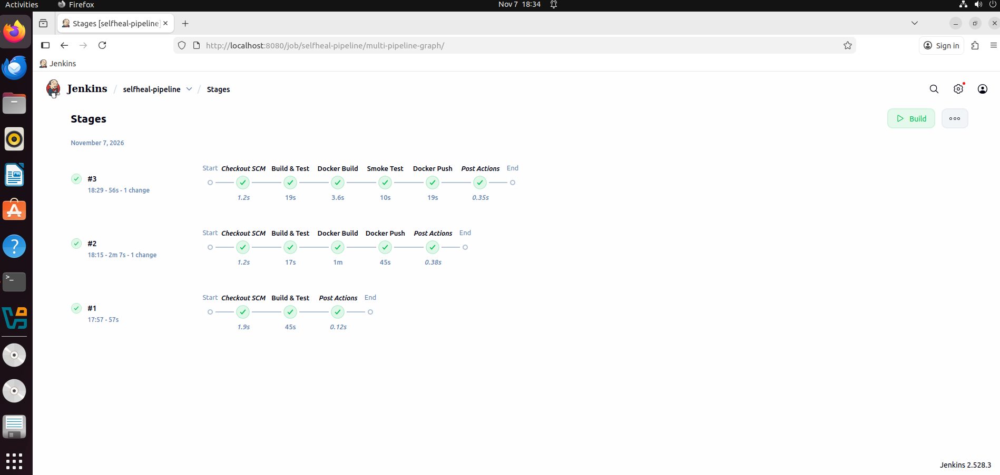

# Self-Healing Containerized Java Application on AWS

> Personal DevOps lab project. A Java app that **detects failures and recovers automatically**: built with Docker, and (in progress) deployed on AWS with Terraform, Jenkins and CloudWatch.

## Why I built this
I work as a Middleware Administrator supporting Java applications. In production support, JVM crashes, OutOfMemoryErrors and HTTP 500s are usually detected and fixed **manually**. This project automates that detection and recovery using DevOps tools.

## Current status
| Phase | Description | Status |
|---|---|---|
| 1 | Spring Boot app with chaos endpoints + Docker self-healing | ✅ Done |
| 2 | Terraform: VPC, subnet, IGW, route table, security group, IAM role, EC2 (tested on AWS, then destroyed) | ✅ Done |
| 3 | Jenkins CI/CD: build → test → Docker build → smoke test → push → deploy + health check | ✅ Done |
| 4 | CloudWatch Agent, alarms, SNS email alerts | ⏳ Planned |
| 5 | ALB + Auto Scaling (multi-AZ) + chaos demo | ⏳ Planned |
| 6 | Kubernetes deployment with liveness/readiness probes | ⏳ Planned |

## Chaos endpoints (built-in "break buttons")
| Endpoint | What it simulates |
|---|---|
| `GET /` | Normal response (shows which container answered) |
| `GET /actuator/health` | Health check used by Docker / ALB / Kubernetes |
| `GET /api/error` | HTTP 500 application error |
| `GET /api/slow` | Slow response (15 seconds) |
| `GET /api/memory` | Allocates 50 MB per call → OutOfMemoryError |
| `GET /api/crash` | Kills the JVM (exit code 1) |

## Self-healing tests (Phase 1 results)
| Test | Without fix | With fix | Evidence |
|---|---|---|---|
| JVM crash (`/api/crash`) | App stays down (`Connection refused`) | Docker restarts it in seconds | RestartCount 0 → 1 |
| OutOfMemoryError (`/api/memory`) | JVM stays alive but returns 500s; Docker still reports `healthy` | `-XX:+ExitOnOutOfMemoryError` → JVM exits → Docker restarts it | `docker events` shows `exitCode=3` |
| Manual `docker stop` | — | Not restarted (respects `unless-stopped`) | `exitCode=143` (SIGTERM) |

## Docker design
- **Multi-stage build:** Maven builds the JAR; the final image contains only the JRE + JAR
- **Non-root user** inside the container
- **HEALTHCHECK** on `/actuator/health`
- **Restart policy** `unless-stopped` + memory limit `512m`

## Run it locally

    cd app
    docker build -t selfheal-app:v2 .
    docker run -d --name selfheal --restart unless-stopped --memory=512m -p 8081:8080 selfheal-app:v2
    curl http://localhost:8081/actuator/health

## Tech stack
Java 17 · Spring Boot · Maven · Docker · Linux (Ubuntu) · Git

## CI/CD pipeline (Jenkins)

| Stage | What it does |
|---|---|
| Build & Test | `mvnw clean package` with unit tests |
| Docker Build | Builds image tagged `build-<N>` and `latest` |
| Smoke Test | Runs the new image, waits for `/actuator/health` = UP, fails the build if not |
| Docker Push | Pushes to Docker Hub using Jenkins credentials (token masked in logs) |
| Deploy | Replaces the running container and verifies health after deploy |

*Coming next:* AWS (VPC, EC2, IAM, ALB, Auto Scaling, CloudWatch, SNS) · Terraform · Jenkins · Kubernetes

## Problems faced & fixes
See [docs/errors.md](docs/errors.md) for every error I hit and how I fixed it.